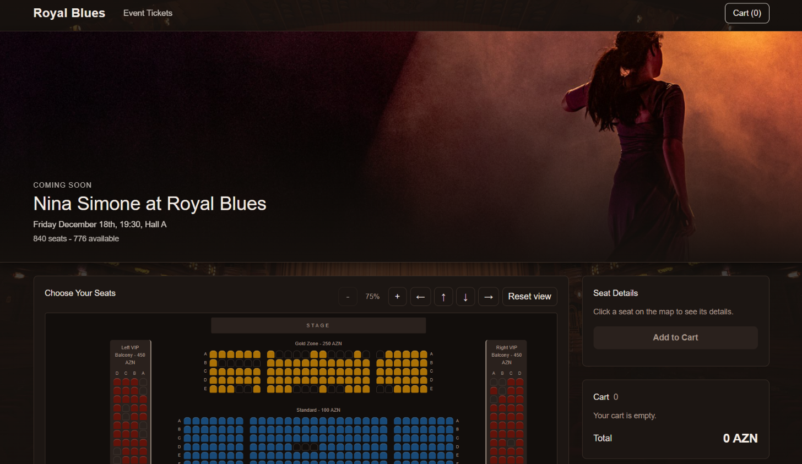

# Royal Blues Theatre 

Ticket selection webpage for the Royal Blues theatre

## Venue

Venue type is theatre

```
                      [      STAGE      ]
 [Left VIP Balcony]   [    Gold Zone    ]   [Right VIP Balcony]
                      [    Standard     ]
     [Left Balcony]   [     Economy     ]   [Right Balcony]
```

| Zone              | Rows | Seats per row | Price    |
|-------------------|------|---------------|----------|
| Left VIP Balcony  | 4    | 12            | 450 AZN  |
| Right VIP Balcony | 4    | 12            | 450 AZN  |
| Gold Zone         | 5    | 24            | 250 AZN  |
| Standard          | 8    | 30            | 100 AZN  |
| Economy           | 10   | 32            | 50 AZN   |
| Left Balcony      | 4    | 8             | 120 AZN  |
| Right Balcony     | 4    | 8             | 120 AZN  |

840 seats in total, 64 of them already sold.

## Data model

`data.js` has one `venue` object:

- `categories` - name and price of each ticket type
- `sections` - id, name, category, rows, seats per row, aisles and side (for the balconies)
- `sold` - seats that are already unavailable

Each section id matches a grid area in `style.css`, which places the section on the map.
Seat ids are section id + row letter + seat number, such as `GZ-C7` which is Gold Zone, row C, seat 7.

`script.js` loops through every section and row and creates a `<button>` for each seat, so no seats are written by hand in the HTML. Each seat gets an id like `GZ-C7` and is saved in a `seats` object so it can be found quickly. The cart is an array of seat ids that is saved to localStorage on every change, and on page load it is read back and the seats get their in-cart state again.


## Features

- A substantial venue map with multiple sections/zones and different price categories
- Repeated seats generated from JavaScript data, not copy-pasted into HTML
- Individual interactive controls for selectable seats, using `button` elements
- The user can inspect a seat and see its identifying details and price before adding it to the cart
- Clear seat states: available, currently inspected, in cart, and unavailable
- Visible controls for Zoom In, Zoom Out, Move Up, Move Down, Move Left, Move Right, and Reset/Center View
- An ADD TO CART action after seat inspection
- Cart items, ticket prices and the total price are shown, and tickets can be removed
- The map and cart are synchronized: removing a ticket from the cart updates the corresponding seat
- The same seat cannot be added more than once
- The cart is stored in localStorage, and both the cart and matching seat states are restored after page refresh
- A responsive and usable interface

### Extras

- A Clear all button in the cart and a limit of 8 tickets
- Clicking a seat in the cart shows its details
- After clicking the map, the arrow keys move it and the +/- keys zoom it

### Bonus

- Optional mouse navigation: mouse-wheel zoom and click/drag panning, while all required +/- and directional navigation buttons still work

## Files

- `main.html` - page structure
- `style.css` - all styles
- `data.js` - venue data
- `map.js` - zoom, moving the map, mouse, touch and keyboard navigation
- `script.js` - building the venue, seat details, cart and localStorage 

## Preview
